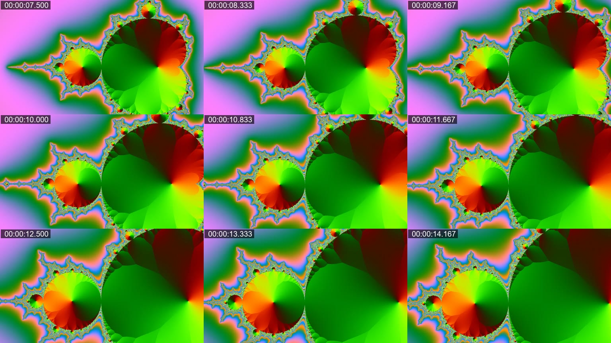

# vidgrid

[](https://github.com/Arekosandoru/vidgrid/actions/workflows/ci.yml)
[](https://www.python.org/)
[](LICENSE)

**Turn a video into timestamped contact sheets an AI agent can read.**

Agents cannot play video. They read images — and every image is a separate read,
a separate tool call, a separate chunk of context. Ask an agent to "look at this
three-minute recording" and you get either 180 near-identical screenshots or a
guess.

`vidgrid` collapses a clip into a handful of tiles: nine stills per image, each
with its timecode burned into the corner, plus a `sheets.json` manifest saying
exactly which second every tile belongs to. The agent reads four images instead
of two hundred, then asks for the one full-size frame that matters.

```
clip.mp4: 30.0s, 3x3 tiles of 512px, 36 frames in 4 sheet(s) (00:00:00.000 -> 00:00:29.167)
  sheet_01.jpg  00:00:00.000 .. 00:00:06.667
  sheet_02.jpg  00:00:07.500 .. 00:00:14.167
  sheet_03.jpg  00:00:15.000 .. 00:00:21.667
  sheet_04.jpg  00:00:22.500 .. 00:00:29.167
manifest: ./clip.vidgrid/sheets.json
```



## Why not just extract frames?

Because the bottleneck is not disk, it is the agent's context and attention.

| | 36 separate frames | 4 vidgrid sheets |
|---|---|---|
| Image reads | 36 tool calls | 4 tool calls |
| Ordering | has to be inferred from filenames | top-left to bottom-right |
| Timestamps | whatever the filename says | burned into every tile |
| Cost | grows with frame count | pinned by the grid |

Each sheet is also small enough to stay legible: tiles default to 512 px, so a
3×3 sheet is 1536 px wide and reads fine in a vision model.

## Install

Requirements: **Python 3.10+** and **ffmpeg + ffprobe** on `PATH`
(`winget install --id Gyan.FFmpeg -e`, `brew install ffmpeg`, `sudo apt install ffmpeg`).

```bash
uv tool install git+https://github.com/Arekosandoru/vidgrid
# or
pipx install git+https://github.com/Arekosandoru/vidgrid
# or run without installing anything
uvx --from git+https://github.com/Arekosandoru/vidgrid vidgrid --help
```

There are no Python dependencies. The whole tool is one file.

## Use

```bash
# 36 frames in a 3x3 grid → 4 sheets, timestamps on by default
vidgrid clip.mp4

# denser: 64 frames in a 4x4 grid
vidgrid clip.mp4 --grid 4x4 --count 64

# one frame every two seconds, only the interesting part
vidgrid clip.mp4 --interval 2 --start 1:30 --end 2:00

# the frame an agent asked about, at full resolution
vidgrid clip.mp4 --at 1:23.5
```

| Option | Default | Meaning |
|---|---|---|
| `--out DIR` | `./<video>.vidgrid/` | where sheets and `sheets.json` go |
| `--grid COLSxROWS` | `3x3` | tiles per sheet |
| `--count N` | `36` | total frames to sample; sets the interval |
| `--interval SEC` | — | fixed gap between frames (`2`, `1:30`, `500ms`) |
| `--start` / `--end` | whole clip | limit the range (`0:30`, `1m10s`) |
| `--tile-width PX` | `512` | width of one tile; never upscales past the source |
| `--at TIME` | — | grab one full-size frame instead of sheets |
| `--quality N` | `3` | JPEG quality, 1–31, lower is better |
| `--no-timestamps` | off | stop burning timecodes into tiles |
| `--font PATH` | auto | font for the overlay |
| `--json` | off | print the manifest to stdout |

## Give it to your agent

`skills/vidgrid/SKILL.md` is an [Agent Skill](https://agentskills.io) that tells
an agent when to reach for `vidgrid` and how to read the result.

```bash
# any Agent Skills host (Claude Code, Codex, Cursor, Copilot, …)
npx skills add Arekosandoru/vidgrid -g --skill vidgrid
```

Then the agent just needs the video:

> Use the vidgrid skill on recording.mp4 and tell me where the tooltip flickers.

The intended loop is always the same:

1. `vidgrid clip.mp4 --count 36` → a few sheets.
2. Read them in order; note the timestamp above the suspicious tile.
3. `vidgrid clip.mp4 --at 1:23.5` → that frame, full size.
4. Narrow with `--start`/`--end` and `--grid 4x4` if the moment is blurry.

## How it works

One ffmpeg pass. The filtergraph is `fps` → `showinfo` → `scale` → `drawtext`
→ `tile`, written to a temporary `filter.txt` and passed with
`-filter_script:v`. Keeping the graph in a file sidesteps the quoting rules that
break `drawtext` on Windows paths and on any argument containing a colon; the
font is copied next to the script so its path never enters the graph at all.

Tile times are read back from ffmpeg's own `showinfo` timestamps rather than
computed with arithmetic, so the manifest matches what is actually on screen.

## Limits worth knowing

- Samples uniformly. There is no scene detection — that is deliberate, because
  most agent-facing footage is a screen or gameplay recording with no cuts.
- A clip with fewer frames than the grid leaves black cells in the last sheet;
  the summary marks it `(partial)`.
- Timestamps rely on a system font. If none is found, pass `--font` or use
  `--no-timestamps`; nothing else breaks.
- Not a video *understanding* tool. It prepares evidence; the model does the
  reading. For transcripts or OCR, pair it with a dedicated tool.

## Development

```bash
uv run --with pytest pytest -q
```

Tests synthesize their own clips with `ffmpeg -f lavfi`, so they need no network
and no fixtures. CI runs them on Linux, macOS and Windows.

## License

MIT — see [LICENSE](LICENSE).
